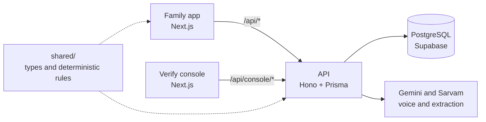

<p align="center"></p>

# Keeper — Financial Legacy

[](https://github.com/snehagupta50417/keeper/actions/workflows/ci.yml)


After a death, families often cannot find what the person owned, or what each institution needs before it will release it. Keeper has two sides: a **family app** that finds evidence of assets and prepares claims, and a **Verify console** that helps banks and insurers check those claims and decide them. Keeper prepares the next step; people review consequential changes and institutions verify and decide claims.

**Synthetic MVP, not a production financial service.** See [current implementation status](docs/CURRENT_STATE.md) for the dated audit and known failures.

## Try it

**Live demo (synthetic data only, no sign-in):** https://keeper-web-943047518295.asia-south1.run.app

| | What you get | Open |
| --- | --- | --- |
| **Family app** | Talk to Keeper, review evidence, build a claim package. Press "Explore an example" for a guided walk-through of a fictional family, or "Get started" for your own empty workspace. | [Open the app](https://keeper-web-943047518295.asia-south1.run.app/app) |
| **Verify console** | A bank or insurer desk with four synthetic death claims, four checks (consistency, authenticity signals, duplicate claim, completeness), a risk rating from fixed rules (never an AI model) and a decision a person makes. | [Open /verify](https://keeper-web-943047518295.asia-south1.run.app/verify) · [walkthrough](docs/VERIFY_DEMO.md) |

There is no login. Each browser gets its own private workspace. Cloud Run services scale to zero, so the first visit after a quiet period can take a few seconds.

## How it fits together



Code decides access, risk and entitlement; models only extract and phrase, and their output is validated. Hosted on Google Cloud Run (free tier) with Supabase PostgreSQL.

## What works today

- **Verify:** a claims console for institutions with deterministic risk ratings, evidence for every flag, simulated document requests, an audit trail with CSV export, and a heir-side note that a self-submitted package can arrive pre-checked.
- Conversation-first web app, saved text/call conversations, contextual return briefing and structured record views.
- Supabase PostgreSQL persistence for the validated local runtime; SQLite remains available for isolated development/tests.
- Local OCR and AI extraction, source excerpts, field review/history, evidence labels and dated amounts.
- Guided official searches with saved outcomes; reviewed evidence and confirmed holdings advance into claim drafts.
- Bounded agent preparation with saved checkpoints, receipts, pause/resume/recheck and concrete review targets.
- Versioned claim packages, content-hash approval, PDF, official handoff, recorded self-submission and outcome tracking.
- Consent controls, application-data deletion, family notes and in-app follow-up preferences.

Voice input is integrated with Sarvam, Gemini and browser fallbacks. **Latest server voice-output check failed because Gemini TTS quota was exhausted.** Browser speech remains the fallback and actual user microphone reliability requires device acceptance. See [voice status](docs/VOICE.md). Support for every language is not claimed.

The four evidence statuses are `self_declared`, `potential_match`, `document_backed`, and `institution_verified`. A document or model confidence never establishes entitlement or real institutional verification. Financial identity/authority providers remain simulated. No real claim submission, funds movement, trusted-contact sharing or exhaustive discovery is offered.

## Running it

Node.js 22 or newer is required. The API and web app run separately; shared types and pure rules live in `shared/`.

### Local SQLite development

From the repository root in PowerShell:

```powershell
npm install
npm run install:all
Copy-Item backend/.env.example backend/.env
npm run db:prepare --prefix backend
npm run db:setup --prefix backend
npm run dev
```

Copy the example only for a new setup; preserve an existing private `.env`. Check `DATABASE_URL` selects the intended local SQLite file before schema setup. `db:setup` explicitly creates/updates that schema; ordinary startup never initialises it. Do not use reset or data-loss commands to repair a configured database.

Default development addresses: web http://localhost:3000 and API http://localhost:4000. `/api/*` is proxied to the API. `/api/health` checks liveness; `/api/ready` checks database reachability, not OAuth or voice acceptance.

### Existing local Supabase runtime

The validated local setup uses web http://localhost:3001 and API http://localhost:4001, with private `.env.supabase-local` files. It is intentionally synthetic-session mode. Follow [LOCAL_SUPABASE_VALIDATION](docs/LOCAL_SUPABASE_VALIDATION.md) for generation, start commands and Windows setup-helper guidance. Keep the original SQLite file intact.

### AI configuration

From the repository root, `npm run set-key` prompts privately for an existing Gemini key; `npm run set-sarvam-key` does the same for Sarvam. These helpers target `backend/.env`; a separate runtime env must be configured privately too. Restart the API after configuration changes. Never paste secrets into chat or commit them.

Without AI, intake/extraction can use rules and local OCR, and Q&A can return matching passages. Free credentials have quotas; the app must preserve text and saved work on provider failure. Synthetic data only; review [FREE_TIER_PLAN](docs/FREE_TIER_PLAN.md) before changing providers.

## Checks

```powershell
npm run typecheck
npm test
npm run lint --prefix frontend
npm run build
```

Tests use disposable SQLite data and fixtures, not the Supabase application database. OCR downloads English/Hindi data once and needs network on a cold cache. Tests do not call live AI unless explicitly enabled; a green fixture suite is not evidence of live-provider availability. See [CURRENT_STATE](docs/CURRENT_STATE.md) for the dated audit.

## Hosting and authentication

The live demo runs with `PUBLIC_DEMO=1`: no sign-in, one synthetic workspace per browser. Without it, hosted mode requires Supabase Google sign-in. Use [HOSTED_MVP_SETUP](docs/HOSTED_MVP_SETUP.md) and [CLOUD_SETUP](docs/CLOUD_SETUP.md). Production requires external PostgreSQL, configured Supabase authentication and an HTTPS web origin. Google account sign-in is separate from financial authority. Deploy source packages made by `scripts/prepare-cloud.mjs` so each service includes `shared/`. Never deploy container-local SQLite as persistent storage.

## Documentation

Read [ONE_PAGER](ONE_PAGER.md) → [PRD](PRD.md) → [LLD](LLD.md) → [DESIGN](DESIGN.md). [BRD](BRD.md) covers business hypotheses; [DECISIONS](DECISIONS.md) is historical and append-only. The [documentation index](docs/README.md) links setup, security, privacy, evaluation and workflow guides. Proposed requirements are distinct from implementation status.

## Licence

MIT. See [LICENSE](LICENSE). All data in this repository is synthetic.
